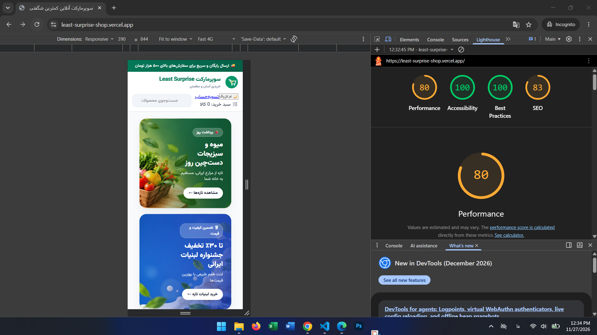

# Least Surprise


A Persian online grocery store built with React, TypeScript and Vite as part of the Gang of Forty bootcamp.

## Live Demo

- Production: https://least-surprise-shop.vercel.app/
- Preview: https://least-surprise-shop-67fwp5e86-vania-least-surprise.vercel.app/

## Features

- Responsive Persian RTL interface
- Product browsing and categories
- Product search and sorting
- Product details
- Shopping cart with persistent storage
- Checkout page
- Light and dark themes
- Home page banners and product carousels

## Tech Stack

- React 19
- TypeScript
- Vite
- TanStack Router
- Zustand
- Notyf
- Docker
- Nginx
- GitHub Actions
- Vercel

## Getting Started

Install dependencies:

    npm install

Start development server:

    npm run dev

Build for production:

    npm run build

Preview production build:

    npm run preview

## Docker

### Build locally

```bash
docker build -t least-surprise .
```

### Run locally

```bash
docker run --rm -p 8080:80 least-surprise
```

Open http://localhost:8080

### Pull and run from GitHub Container Registry

Pull the published image:

```bash
docker pull ghcr.io/vania-gh/least-surprise-shop:1.0.0
```

Run the container:

```bash
docker run -d -p 8080:80 --name least-surprise ghcr.io/vania-gh/least-surprise-shop:1.0.0
```

You can also use the `latest` tag:

```bash
docker pull ghcr.io/vania-gh/least-surprise-shop:latest
```

Open http://localhost:8080

Stop and remove the container:

```bash
docker stop least-surprise
docker rm least-surprise
```

## CI

Run project checks:

    npm run ci

This runs linting, TypeScript checks and the production build.

## Deployment

The production site is deployed on Vercel.

## Mobile Screenshot


## Lighthouse Mobile Report

